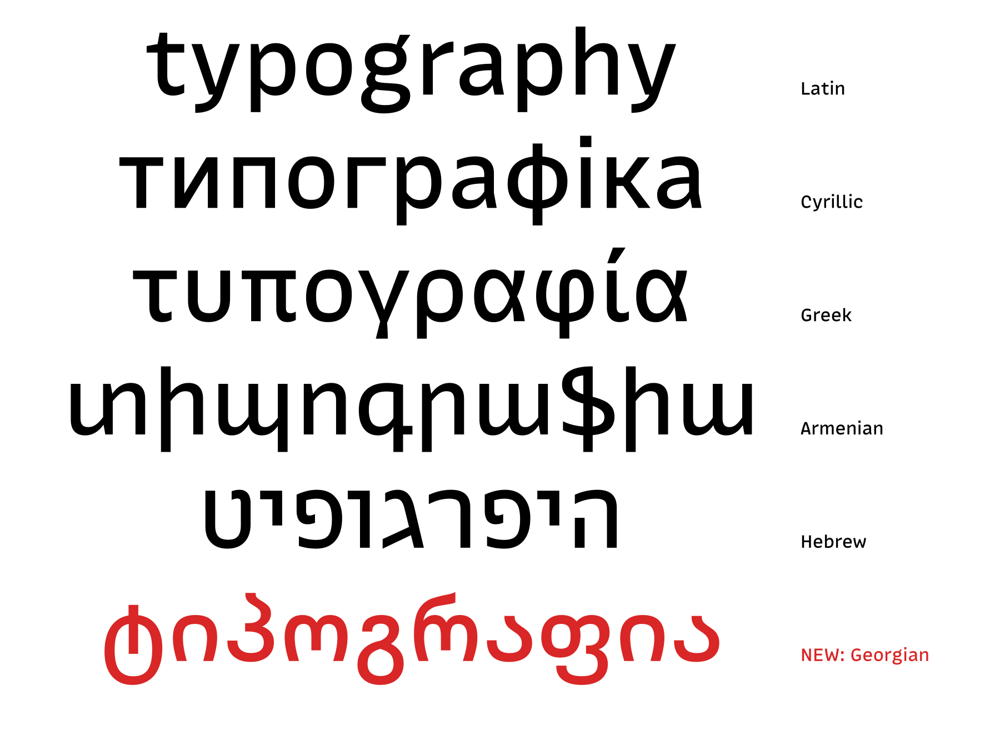

The first update to [MonoLisa version 3](/posts/monolisa_v3) brings Georgian support to both MonoLisa Code and MonoLisa Text. Version 3.001 also adds a dotted zero to tabular figures in MonoLisa Text and makes a series of refinements across the two families.

## Georgian joins MonoLisa

MonoLisa Code and MonoLisa Text now support the Georgian script and language. This extends the scripts available in both the monospaced family for code and its proportional companion for text.

## A dotted zero for tabular figures

MonoLisa Text now includes a dotted zero (`zero.tf.ss15`) for tabular figures. Tabular figures use equal widths for numbers, which helps keep columns aligned in contexts such as tables. The dot provides another way to distinguish zero from the letter O.

## Fixes and refinements

The update also includes smaller adjustments to ligatures and individual glyphs:

- **MonoLisa Code:** The discretionary ligature (`dlig`) lists are synchronized between upright and italic. The Hebrew letter Vav (`vav-hb`) has been adjusted in all three masters.
- **MonoLisa Text:** The letter `đ` (`dcroat`) and the Vietnamese dong sign `₫` (`dong`) have been corrected in all three upright masters.
- **Both families:** The Turkish lira sign `₺` (`liraTurkish`) has been optimized across MonoLisa Code and Text, and the tenge sign `₸` (`tenge`) has been optimized in all masters across both families.

These changes continue the work we started with version 3: extending where MonoLisa can be used while refining the details of the typeface. Existing customers can download the latest version from [My orders](/orders). If you haven't tried the new families yet, you can [try MonoLisa](/buy/trial/).
