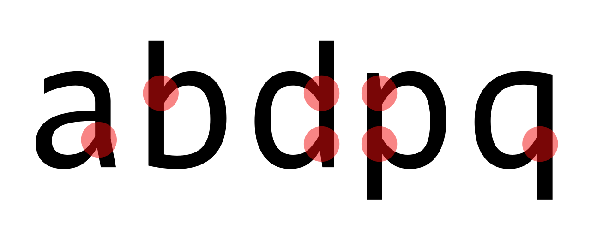

Hi,

One place you can see what’s changed since MonoLisa 1 is in the word `debug`. We redrew the `d` and the `b`, along with `p` and `q`, to make them easier to tell apart at editor sizes. The red dots show where the curves meet the stems.

Here’s what else you’ll find in v3.

- **More control over your coding font.** You can draw `->` as an arrow and keep `===` as three separate signs. Save that combination in a custom font and it follows you from your editor to your terminal.
- **New terminal symbols.** We drew glyphs for progress bars and added check and cross marks such as `✓` and `✗` for output like test results.
- **A companion for writing.** Developer + Text pairs MonoLisa Code with MonoLisa Text, a proportional family for prose. On a personal site you can set an article in Text and its examples in Code, then download webfonts containing just the character ranges you need.
- **Broader language support.** We expanded Latin and Cyrillic coverage, refined Vietnamese accents, and added Armenian, Hebrew, and Georgian.

During Black Week, you get **30% off your paid upgrade** through Sunday, November 29.

[See my upgrade options](https://www.monolisa.dev/orders)

--
Andrey, Juho, and Marcus

<a href="{{ unsubscribe_url }}">Unsubscribe</a>

