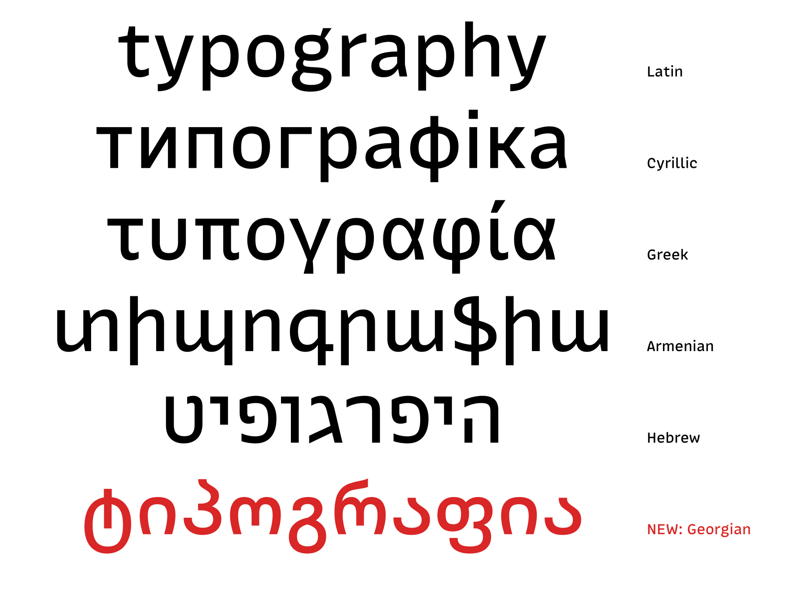

Hi,

MonoLisa 3.001 is here. Our first update since version 3 adds Georgian support to both MonoLisa Code and MonoLisa Text, along with a new dotted zero and a number of smaller refinements.

## Georgian joins MonoLisa

Both font families now support the Georgian script and language. Here's how Georgian looks alongside some of the other scripts in MonoLisa:

## A dotted zero for tabular figures

MonoLisa Text now includes a dotted zero in its tabular figures (`zero.tf.ss15`). Tabular figures keep numbers aligned in columns, and the dot gives you another way to distinguish zero from the letter O.

## Other refinements

We've also made a collection of smaller fixes across the two families:

- In MonoLisa Code, the discretionary ligature (`dlig`) lists now match between upright and italic, and the Hebrew letter Vav has been adjusted in all three masters.
- In MonoLisa Text, we've corrected `đ` and the Vietnamese dong sign (`₫`) in all three upright masters.
- In both Code and Text, we've optimized the Turkish lira sign (`₺`) and the tenge sign (`₸`), the latter in all masters.

We hope you enjoy the update!

--
Andrey, Juho, and Marcus

<a href="{{ unsubscribe_url }}">Unsubscribe</a>

